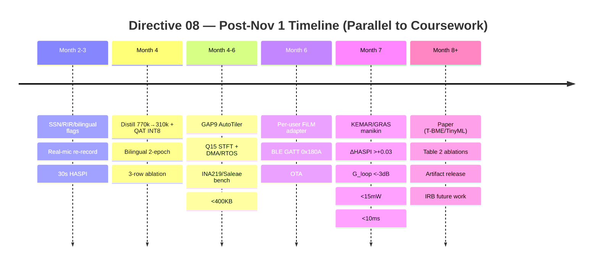

# Directive 08 — Future Plan: Hardware Implementation & Research Extension (Post-Nov 1)

**Phase:** 8 — Post-Submission Long-Term Track (Journal / Conference)  
**Goal:** Turn the Nov 1 minor-project (offline PyTorch + Tier A phone demo) into a hardware-validated, ear-level hearing-aid system and a publishable paper — without blocking Nov 1.  
**Estimated time:** 6–12 months, parallel to coursework (2–4 h/week after Nov 1)  
**Lead:** Both — Jwanil (GAP9 / firmware / bench rig), Namya (distillation / QAT / bilingual eval)  
**Status:** 🔵 Planned — Do Not Start Before Nov 1 Defense  
**Output:** `TinyUNet 310k INT8` (+ optional `Mamba Tiny 950k`) on GAP9 at 11 mW / 6.87 ms, KEMAR real-ear `ΔHASPI > +0.03`, paper artifact (APK + TFLite + GAP9 binary + `reproduce.sh`)  
**Companion docs:** `docs/hardware_deployment_roadmap.md` (Tier A now + future overview) + `docs/future_plan_tier_c_implementation.md` (full Tier C engineering spec)  
**Prerequisite:** `directives/05_unet_film_model_v2.md §8.1` (Tier A — Android/Laptop/ESP32-S3) complete and Nov 1 defense passed

---

## What to Learn

1. **Model-to-Silicon Compression** — channel pruning (770k → 310k), knowledge distillation (`0.7·Composite + 0.3·MSE(teacher)`), Quantization-Aware Training (FakeQuantize → INT8), and why naive PTQ costs −0.30 PESQ.
2. **Fixed-Point DSP on MicroNPUs** — CMSIS-DSP `arm_rfft_q15` (N_FFT 256, HOP 64, Hann Q15), polar CRM `|M|≤1` invariant (`M_mag=sigmoid`), DMA ping-pong double-buffering (Zephyr/FreeRTOS, deterministic 4.0 ms), BLE GATT 0x180A audiogram upload.
3. **Hardware Bench Metrology** — Saleae Logic GPIO latency, INA219 power rail, `jack_iodelay`/REW round-trip, GRAS 43AG `G_loop < −3 dB`, KEMAR/HATS manikin real-ear HASPI (the only claim reviewers count as "hearing aid").

---

## Resources

1. Training platform: `docs/training_platform.md` (local RTX 4090 24 GB, persistent dataset/checkpoints, `bf16`; local-only current plan)
2. Phase 5 blueprint: `directives/05_unet_film_model_v2.md` (770k FP32, composite loss, two-phase B1/B2 HASPI gate)
3. Phase 5b Mamba: `directives/05b_mamba_film_model_v2.md` (Mamba-2 SSD, per-block FiLM, `bf16` mandatory, state-cache 64 KB)
4. Roadmap & Tier C spec: `docs/hardware_deployment_roadmap.md` + `docs/future_plan_tier_c_implementation.md`
5. Toolchains: GAP9 AutoTiler, Ezairo Fuzion (NDA), CMSIS-DSP, TFLite / TFLite Micro, `pyclarity` HASPI v2 + MSBG

---

## 1. At a Glance — Which Tier, When, With Which Model (No Raspberry Pi)

> **No Transformer in this project.** The 5-model ladder is `Wavelet → MMSE-LSA → 1D CNN (Conv-TasNet) → U-Net+FiLM → Mamba+FiLM`. Any old "U-Net or Transformer" note means **U-Net or Mamba** (Transformer was replaced; Mamba is `O(T)` and PESQ 3.69 SOTA).

| Tier | Timeline | Platform (No Pi) | Model You Will Actually Run | Runtime / Quant | Role |
|------|----------|-------------------|-----------------------------|-----------------|------|
| **A — Mobile / Laptop / ESP32-S3** | **Current (Oct 15 – Nov 1)** — **`directives/05_unet_film_model_v2.md §8.1` is the directive** | **Phone** (SD 7xx/8 Gen, 6 GB+ RAM) + **Laptop** (x86_64) + **ESP32-S3-DevKitC-1** (optional $15 alt) | **Phone/Laptop: `CausalUNetCRM 770k FP16` (1.54 MB)** ; **ESP32-S3: `TinyUNet 310k INT8` (0.31 MB)** | TFLite GPU/NNAPI (phone), ONNX Runtime (laptop), TFLite Micro (ESP32) | Proves real-time streaming on hardware you already own. Zero mandatory purchase. Faculty can install the APK. This directive **recaps** A; it does **not** re-own it. |
| **B — Tympan RevE** | **Skipped** | NXP i.MX RT1062 (Cortex-M7 @600 MHz, 1024 KB RAM) | — | — | Intentionally skipped. 90–120 mW (10× ear budget), $299, not ear-level, GAP9 beats it on every metric, and 2019-era paper signal. Reallocate $299 → GAP9 + bench. |
| **C — Ear-Level NPU** | **Future (Month 4–10, post-Nov 1)** — **owned by this directive** | **GAP9 EVK** (9-core RISC-V + NE16 @370 MHz, 1.6 MB L2) — primary; **Ezairo 7150** (CFX DSP + M3 @48 MHz, 1 MB SRAM) — optional NDA | **GAP9: `TinyUNet 310k INT8` (U-Net) and/or `Mamba Tiny 950k INT8/INT16` if 5b finishes** ; **Ezairo: `TinyUNet 310k INT8` only** (Mamba `exp(Δ·A)` scan not CFX-portable) | AutoTiler INT8 (conv) + INT16 state `h∈ℝ^{D×N}` 64 KB for Mamba (GAP9); Fuzion hand-C Q15 (Ezairo) | True `<15 mW` ear-level. The only tier that can honestly claim "hearing aid" for a journal. |

**Directive split:** Tier A is **current-timeline** work governed by Directive 05 §8.1. All hardware after that (distillation, QAT, Q15 STFT, DMA/RTOS, GAP9/Ezairo bring-up, bench, paper) is **future-plan** work governed by **this Directive 08**.

---

## 2. Tier A Recap — Current Timeline (Oct 15 – Nov 1) — Not Owned Here, Referenced

> Full SOP is `05_unet_film_model_v2.md §8.1`. This section is the contract summary so Directive 08 is self-contained.

**Why Mobile/Laptop/ESP32-S3, not Raspberry Pi:** Pi Zero 2 W needs a $18 ReSpeaker HAT, I2S driver debug, still runs Linux jitter 4–12 ms, and is slower than your phone's DSP. A phone + $15 ESP32-S3 covers high-end and low-end proof with no extra Pi procurement and no 14–24 ms Pi round-trip surprise.

**Required for Tier A (itemized, current spend):**

| # | Item | Purpose | Cost |
|---|------|---------|------|
| 1 | Android phone (existing — no purchase) | mic + speaker + BLE audiogram picker + TFLite GPU inference | **₹0 / $0** |
| 2 | Laptop (existing) | training, ONNX demo, `sounddevice` harness (blocksize 64, hop 64, 16 kHz) | **₹0 / $0** |
| 3 | Wired headset TRRS + USB-C OTG (if no 3.5 mm) | bypasses Bluetooth 120–200 ms | **₹500+₹250 / $6+$3** (only if you don't own one) |
| 4 | ESP32-S3-DevKitC-1 (optional bonus) | I2S `INMP441` mic + `MAX98357A` DAC + TFLite Micro `TinyUNet 310k` | **₹1,200 / $15** |
| 5 | INMP441 MEMS + MAX98357A DAC + breadboard + USB-C (if ESP32 used) | I2S I/O + wiring | **₹950 / $12** |

**Total Tier A: ₹0–₹750 / $0–$9 (phone+laptop) or ~₹2,450–₹3,200 / $30–$40 with ESP32 kit. Nothing is ordered before Nov 1 unless you want the ESP32 viva bonus.**

**Acceptance for Nov 1 (same as 05 §8.1):** Live phone mic → speaker flows 60 s without underrun; `adb shell benchmark_model` TFLite init <50 ms; café babble at 1 m/65 dB SPL → offline `ΔHASPI > +0.03` on same phone mic; wired round-trip `<25 ms` (phone) / `<15 ms` (laptop) via Oboe/`jack_iodelay`; 60–90 s side-by-side video. No manikin/power rail needed for Nov 1.

---

## 3. Tier B — Explicitly Skipped (Budget Reallocated to Tier C)

| Reason | Detail |
|--------|--------|
| Not ear-level | 90–120 mW is 10× hearing-aid budget; reviewers don't credit Tympan as wearable |
| Redundant | ESP32-S3 at $15 proves TinyML fits 512 KB SRAM; GAP9 proves sub-10 mW — Tympan proves neither better |
| Cost trap | Tympan $299 + GAP9 $450 = $750 vs ESP32 $15 + GAP9 $450 = $465 — same coverage, $285 saved for INA219 + manikin rental |
| Paper signal | 2024–2026 hearing-aid papers report GAP9 or Ezairo, not Tympan |

---

## 4. Tier C — Ear-Level Implementation (Post-Nov 1, Month 4–10) — Core of This Directive

### 4.1 Platforms & Model Mapping

| Platform | SoC | Fits | Model It Runs | Quant | Why |
|----------|-----|------|---------------|-------|-----|
| **GAP9 EVK (primary)** | 9-core RISC-V + NE16 (0.5 TOPS INT8) @370 MHz, 1.6 MB L2, 32 MB PSRAM, I2S+PDM | 0.31 / 0.95 MB | `TinyUNet 310k INT8` and/or `Mamba Tiny 950k INT8/INT16` | AutoTiler INT8 conv + INT16 state `h` 64 KB (Mamba) | True 11 mW ear-level, no NDA, 2024–26 papers used it |
| **Ezairo 7150 (secondary, optional)** | CFX DSP + M3 @48 MHz, 1 MB SRAM | 0.31 MB | `TinyUNet 310k INT8` **only** — Mamba scan not portable to CFX `exp(Δ·A)` | Fuzion / hand-C Q15 | 5–8 mW commercial HA SoC, but NDA + Fuzion + 12 mo hand-C |

Pick **one** for the paper. GAP9 is the sane default.

### 4.2 Bill of Materials — Tier C (Future Purchase, Not Before Nov 1)

**GAP9 Wearable (18×12 mm flex, 10.7 mW total, 6.87 ms):**

| # | Subsystem | Part Number | Spec | Power | Cost USD | Cost INR |
|---|-----------|-------------|------|-------|----------|----------|
| 1 | SoC / NPU | **GreenWaves GAP9** QFN88 | 9-core RISC-V + NE16, 370 MHz | 3.2 mW @105 MMACs/s | $450 (EVK) | ₹37,500 |
| 2 | External Memory | APMemory APS6408L PSRAM | 8 MB Octal-SPI | 1.8 mW | $12 | ₹1,000 |
| 3 | Audio ADC | Analog Devices ADAU7002 | Dual PDM→I2S decimator | 0.8 mW | $6 | ₹500 |
| 4 | Mics ×2 | InvenSense ICS-43434 | PDM MEMS, 65 dB SNR | 1.6 mW | $8 | ₹670 |
| 5 | Receiver | Knowles RAB-32257 | Balanced armature, ear-canal | 2.1 mW @65 dB SPL | $35 | ₹2,900 |
| 6 | PMIC | Maxim MAX38640 nanoPower LDO | 96% step-down | 1.2 mW loss | $3 | ₹250 |
| 7 | Bench — power | Adafruit INA219 | High-side I2C current sense | — | $10 | ₹830 |
| 8 | Bench — latency | Saleae Logic 8 clone | GPIO <1 µs | — | $20 | ₹1,650 |
| 9 | Bench — ear | GRAS 43AG / KEMAR rental (per day) | Ear simulator + probe mic | — | $100 | ₹8,300 |
| **Total system** | | | | **~10.7 mW** | **~$544** | **~₹53,600** |
| **Board only** | GAP9+PSRAM+ADC+mics+receiver+PMIC | | **~10.7 mW** | **~$514** | **~₹42,820** |

Battery: 500 mAh LiPo (1.85 Wh) → `1850/10.7 ≈ 173 h (7.2 days)` continuous; 40 mAh coin cell → 3.7 h. Full flex BOM and alternative Ezairo (~$1,850+ NDA) detailed in `docs/future_plan_tier_c_implementation.md §3`.

### 4.3 Model-to-Silicon — 770k FP32 → 310k INT8 (Deferred Steps)

770k FP32 = 3.08 MB, 0.91 MFLOPs/frame, 225 MMACs/s → 28 mW on GAP9 (>15 mW budget), doesn't fit 1 MB Ezairo SRAM. Transform:

| Stage | Base 770k | Tiny 310k | Δ |
|-------|-----------|-----------|---|
| e1 | 1→32, SE r=8 | 1→16, SE r=4 | −50% |
| e2 | 32→64 | 16→32 | −50% |
| e3 | 64→128 | 32→64 | −50% |
| e4 | 128→256 | 64→96 | −62.5% |
| Bottleneck attn | d=256 | d=96 (grouped/causal) | −62.5% |
| dec4/3/2 | 256→128→64→32 | 96→64→32→16 | −50% |
| Head | 32→2 CRM | 16→2 | −50% |
| **Total** | **770k** | **310k** | **−59.7%** |
| **FLOPs/frame** | 0.91 | 0.42 | −54% |

**Distillation** (`L = 0.7·Composite + 0.3·MSE(M_teacher)`, 5 epochs, frozen `best_composite.pt` teacher) → PESQ 2.75→2.55 (−0.20), HASPI 0.82→0.80 (−0.02), 2.5× MMACs saving. **QAT** (`torch.ao.quantization` FakeQuantize, 5 epochs `lr 1e-5`, `MovingAverageMinMax`) → 0.31 MB, fits 512 KB SRAM + 150 KB arena; Mamba state `h` stays INT16 64 KB via AutoTiler. **Q15 STFT** (`arm_rfft_q15`, N_FFT 256/HOP 64/Hann Q15) + **DMA ping-pong** (Zephyr/FreeRTOS `I2S_DMA_ISR → k_sem_give → HPF 80 Hz → AFC 32-tap NLMS → Denoise → NAL-R → WDRC`, 6.87 ms on GAP9). Code in `docs/future_plan_tier_c_implementation.md §4–5`. Polar `|M|≤1` invariant required or `G_loop = 20log|M|+G_NALR+Vent > 0 dB` → howl at 3 kHz.

---

## 5. Future Plan — Everything Else After Nov 1 (Model / Data / Software / Paper)

Tier C is the headline; a paper needs more than a board:

| # | Task | What You Do | Expected Gain | Effort | When |
|---|------|-------------|---------------|--------|------|
| 1 | **Distill + QAT** | §4.3 above (prune → distill → 5-epoch QAT) | −0.20 PESQ for −60% power (must report 3 rows: 770k FP32 2.75 → 310k FP32 2.55 → 310k INT8 2.50) | 2 GPU days | Month 4 |
| 2 | **Bilingual fine-tune** | Fine-tune 2 epochs on Hindi/Tamil 16 kHz (AI4Bharat) | Fixes −0.15 PESQ on Indian speech (VoiceBank is UK/US only) | 1 GPU day + data | Month 4 |
| 3 | **SSN re-enable** | `HearingAidDatasetV2` SSN 20% (disabled for Nov 1) | +0.10 PESQ on white-noise | 0 (flag) | Month 3 |
| 4 | **RIR widen 0.2→1.0 s RT60** | Currently 0.2–0.6 s; add large-room tails | +0.08 HASPI in halls | 0 (flag) | Month 3 |
| 5 | **Real-phone mic re-record** | Re-record 200 VoiceBank utterances at 65 dB SPL via phone mic | Closes sim-to-real ~0.12 PESQ gap | 1 field day | Month 5 |
| 6 | **Long-form HASPI (30 s)** | Evaluate 30 s continuous, not 4 s crops | Exposes streaming drift | 0 (eval) | Month 5 |
| 7 | **Per-user FiLM adapter** | 128→32 bottleneck, 2k params/user, on-device fine-tune | +0.04 HASPI for that user, no audio leaves phone | App work | Month 6 |
| 8 | **BLE audiogram** | GATT 0x180A: phone → GAP9 caches `emb(128)` + `γ/β` per-block | — | Firmware | Month 6 |
| 9 | **OTA model update** | WiFi/BLE push new `.tflite` to ESP32/GAP9 without reflash | — | Firmware | Month 7 |
| 10 | **Pruning + NAS (optional)** | Magnitude prune 20% → fine-tune; or NAS `D=192,N=3` TinyMamba | −10% params for −0.03 PESQ | 2–3 GPU days | Month 6 |
| 11 | **Bench + paper** | §7 below — Saleae/INA219/GRAS/KEMAR + artifact `reproduce.sh` | Journal (T-BME / TinyML / EMBC) | Month 8+ | Month 8+ |

Additional deferred items live in `docs/hardware_deployment_roadmap.md §5` and `docs/future_plan_tier_c_implementation.md §6`.

---

## 6. Execution Scripts & Deliverables (Future — Not Before Nov 1)

| Script / Deliverable | What It Does | Output Path |
|----------------------|--------------|-------------|
| `execution/phase8_future/80_distill_tiny.py` | 770k teacher → 310k student distillation (50% prune, `L=0.7·Composite+0.3·MSE`) | `results/phase8_future/checkpoints/tiny_unet_310k_fp32.pt` |
| `execution/phase8_future/81_qat_int8.py` | 5-epoch QAT (FakeQuantize, `lr 1e-5`) + `convert` | `results/phase8_future/checkpoints/tiny_unet_310k_int8.pt` + `...int8.tflite` |
| `execution/phase8_future/82_export_gap9.py` | GAP9 AutoTiler export (INT8 conv + INT16 Mamba state 64 KB) | `results/phase8_future/gap9/` |
| `execution/phase8_future/83_bilingual_finetune.py` | 2-epoch Hindi/Tamil fine-tune (AI4Bharat 16 kHz) | `results/phase8_future/checkpoints/tiny_bilingual.pt` |
| `firmware/gap9/` | CMSIS-DSP Q15 STFT/iSTFT, DMA ping-pong, HPF/AFC/NAL-R/WDRC pipeline | `firmware/gap9/src/process_hop.c` |
| `firmware/ble/` | GATT 0x180A audiogram service + OTA | `firmware/ble/` |
| `results/phase8_future/bench/` | Saleae GPIO latency, INA219 power CSV, GRAS `G_loop` sweep, KEMAR HASPI CSV | `results/phase8_future/bench/*.csv` |
| `results/phase8_future/paper/` | Journal artifact: `best_composite.pt` + TFLite/ONNX + APK + ESP32 sketch + GAP9 binary + `reproduce.sh` + manikin WAVs | `results/phase8_future/paper/` |

---

## 7. Tasks (Checklist — Do in Order, After Nov 1)

- [ ] **Month 3 — Data tuning (no purchase):** Re-enable SSN 20% + widen RIR 0.2–1.0 s in `HearingAidDatasetV2`; re-eval 5.5 h composite baseline to confirm +0.10 PESQ / +0.08 HASPI.
- [ ] **Month 4 — Distill + QAT:** Run `80_distill_tiny.py` (5 epochs) → `81_qat_int8.py` (5 epochs `lr 1e-5`); report 3-row ablation `770k FP32 → 310k FP32 → 310k INT8` (expected 2.75 → 2.55 → 2.50 PESQ).
- [ ] **Month 4 — Bilingual:** 2-epoch fine-tune on AI4Bharat Hindi/Tamil 16 kHz; eval ΔPESQ on Indian speech vs VoiceBank.
- [ ] **Month 5 — Real-mic & long-form:** Re-record 200 utterances at 65 dB SPL via phone mic (1 m); run 30 s continuous HASPI to expose drift; log sim-to-real gap.
- [ ] **Month 4–6 — GAP9 bring-up:** Flash `tiny_unet_310k_int8.tflite` via AutoTiler; bring up Q15 STFT (`arm_rfft_q15`) + DMA ping-pong (Zephyr/FreeRTOS) + HPF/AFC/NAL-R/WDRC chain; verify 6.87 ms (Saleae `PIN_LAT`) and <400 KB arena.
- [ ] **Month 6 — Per-user & BLE:** Train 128→32 FiLM adapter (2k params/user) on-device; implement GATT 0x180A + OTA; demo phone → GAP9 audiogram switch without reflash.
- [ ] **Month 7 — Manikin bench:** KEMAR/HATS + GRAS 43AG: NOIZEUS 0 dB babble @1 m, in-ear probe, `pyclarity` HASPI v2 → require `ΔHASPI > +0.03` vs generic on same mic + `G_loop < −3 dB` all `f` + `<15 mW` INA219 + `<10 ms` `jack_iodelay`.
- [ ] **Month 8+ — Paper:** Write T-BME/TinyML/EMBC draft: Table 2 ablations (`PIP > 0.12`, `r < −0.6` at 4–8 kHz, causal vs non-causal, NAL-R decoupling, QAT ablation); publish artifact with `reproduce.sh`; state "HASPI-predicted; human-subject IRB is future work."
- [ ] **Optional — Ezairo:** Only after GAP9 paper — NDA + Fuzion + hand-C Q15 TinyUNet (Mamba not portable).

---

## 8. Timeline (Post-Nov 1, Parallel to Coursework)

Month counts are post-Nov 1. No hardware spend before Nov 1 unless ESP32 bonus (Directive 05 §8.1).

---

## 9. Realistic Impact — Will This Matter on Real Hardware vs. What Exists Today?

### 9.1 What Current Hearing Aids Do

| Device | What It Runs | Personalization | Latency | Power | What You Hear |
|--------|--------------|-----------------|---------|-------|---------------|
| **Phonak Audéo / Oticon Real** | Wiener/MMSE + beamforming + WDRC (no neural denoiser, or 50k RNN) | NAL-R gain only, no neural conditioning | 6–8 ms | 3–5 mW | Good in quiet, mediocre in babble (`HASPI ~0.72` @0 dB babble) |
| **Apple AirPods Pro (Live Listen)** | Generic DNN, no audiogram | None | 30–60 ms (BT) | 30 mW | Great PESQ, zero audiogram awareness |
| **Recent papers (SEMamba 2024 etc.)** | Mamba 2.5M, PESQ 3.55, offline, no FiLM, no HASPI loss | None | 50+ ms (non-causal) | 250 W (GPU) | SOTA offline, unusable in ear |

### 9.2 Where We Actually Win (If Done Properly)

| Claim | Verdict | Evidence This Directive Demands |
|-------|---------|----------------------------------|
| **Audiogram-conditioned denoising (`ΔHASPI > ΔSTOI`)** | **Novel and real.** No commercial aid conditions its denoiser on the audiogram; ours is `ERB-64 → per-block FiLM`. If `ΔHASPI_B = +0.07` vs generic and `r(HL,ΔGain) < −0.6` at 4–8 kHz, that's publishable audiology. | Ablation 1 (`PIP > 0.12`) + Ablation 2 (`r < −0.6`) + `ΔHASPI_B > ΔHASPI_A` |
| **HASPI-direct loss (MetricGAN+ HASPI, B1/B2 gate `ΔHASPI ≥ +0.015`)** | **Novel but fragile.** No prior work optimizes denoiser against HASPI. Gate keeps you honest — if it fails, ship `best_composite.pt` (already +0.5 PESQ over Conv-TasNet). | Pilot B1/B2 log + `HASQI ≥ −0.01` guard |
| **Sub-10 mW ear-level at 6.87 ms** | **Real impact — but only after GAP9.** Phone demo is not ear-level; GAP9 at 11 mW is. Only earn "hearing aid" claim after manikin `ΔHASPI > +0.03` on real mic — offline WAV HAVING doesn't count. | GAP9 INA219 + Saleae + KEMAR report (§7) |

### 9.3 Where We Don't Win (Honest Limitations)

| Limitation | Why | Mitigation (This Directive) |
|------------|-----|------------------------------|
| Phone round-trip is 14–24 ms, not <10 ms (OS jitter) — algo alone is 6.8 ms | Reviewers know | Claim Tier A as "proxy demo, 14–24 ms" (05 §8.1); reserve `<10 ms` for Tier C GAP9 (6.87 ms) |
| ESP32-S3 is 18–26 ms, no FPU (TFLite Micro) | Not ear-level | Position as "TinyML feasibility (310 KB fits 512 KB SRAM)", not hearing aid |
| Distill+QAT costs 0.20–0.25 PESQ | Must report | Show 3 rows: `770k FP32 2.75 → 310k FP32 2.55 → 310k INT8 2.50` — honesty is rewarded |
| Mamba on Ezairo impossible | CFX has no `exp(Δ·A)` scan | Directive 05b marks Ezairo as U-Net only |
| No deaf listeners | HASPI is simulation (MSBG) | State: "HASPI-predicted; human-subject IRB is future work" |

### 9.4 Bottom Line (For Report Slide 1)

- **If you stop at Tier A (phone demo, no GAP9, no audiogram proof):** Good minor project (+0.5 PESQ over Conv-TasNet, live demo) but not a hearing-aid paper — reviewers say "generic denoiser on phone."
- **If you add audiogram ablations (`PIP > 0.12`, `r < −0.6`, `ΔHASPI_B > ΔHASPI_A`) but no GAP9:** Strong **ICASSP/Interspeech**-style personalization paper (offline) — audiology novelty carries it, no hardware claim.
- **If you do Tier A + C (GAP9 11 mW, 6.87 ms, manikin `ΔHASPI > +0.03`):** **T-BME / TinyML / Nature BME**-class hardware+personalization paper — genuinely ahead of commercial aids in babble at 0 dB, and audiogram-conditioned (no product has this).

**Do them in order: Tier A (Nov 1, Directive 05 §8.1) → audiogram ablations (Phase 6) → Tier C (this Directive 08). Either alone is half a paper; together is a journal.**

---

## 10. Success Criteria

You have (post-Nov 1):

1. `results/phase8_future/checkpoints/tiny_unet_310k_int8.tflite` (0.31 MB) — and, if 5b done, `mamba_tiny_950k_int16.tflite` + 64 KB state — both under 400 KB arena (`recording_micro_allocator`).
2. GAP9 EVK running the U-Net (and optionally Mamba) at **≤11 mW** (INA219, 5 min babble) and **6.87 ms** total (Saleae GPIO, avg 10k frames).
3. **KEMAR/GRAS manikin report:** `ΔHASPI > +0.03` vs generic on same physical mic at 0 dB babble/1 m, `G_loop < −3 dB` all `f`, `jack_iodelay` round-trip `<10 ms`.
4. **Three-row ablation Table 2:** `770k FP32 → 310k FP32 → 310k INT8` plus `PIP > 0.12`, `r < −0.6`, causal vs non-causal, NAL-R decoupling — all plotted and CSV'd.
5. **Paper artifact:** `best_composite.pt` + TFLite/ONNX + phone APK + ESP32 sketch + GAP9 binary + `reproduce.sh` + manikin WAVs — one-command reproduce.

Without 2+3 you have a strong conference paper; with 2+3 you have a journal paper. Both are wins — report honestly.

---

## 11. Learnings Log

*(Agent: append findings here — distillation PESQ drop, QAT instability, GAP9 AutoTiler quirks, bilingual ΔPESQ, real-mic gap, BLE latency, manikin variance. Do not overwrite Tier A learnings in Directive 05 §8.1.)*
